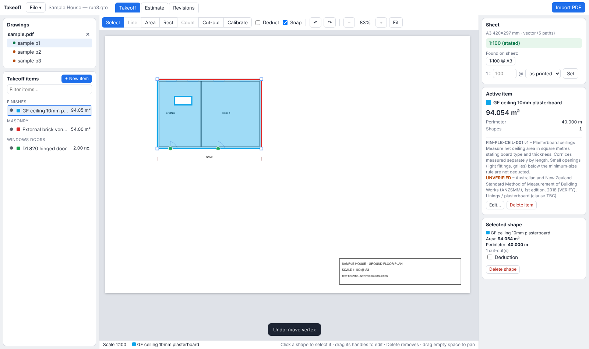
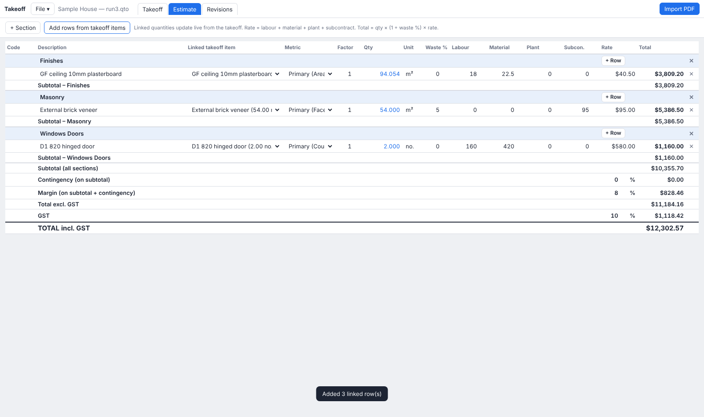
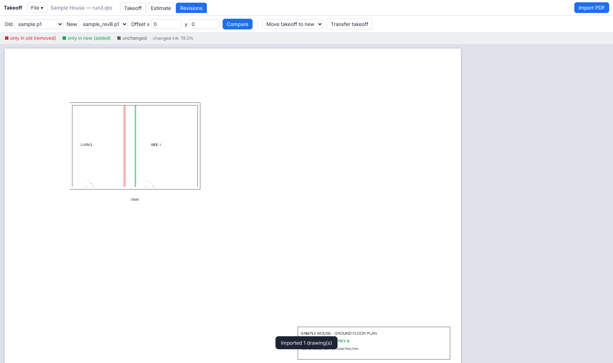

# Takeoff: AU quantity takeoff & estimating (desktop)

A desktop takeoff-and-estimating tool for Australian quantity surveyors, built
around the same workflow as commercial suites such as Cubit and CostX:

**PDF drawings → takeoff items (line, area, count) → estimate workbook linked to
the takeoff → revisions → Excel.**

What it adds: every item cites the **measurement rule** it was measured under
(ANZSMM / AS / NCC reference, version-hashed), so every number in the export can
be traced back to the shapes, the scale and the rule behind it.

> **The starter rules library is unverified.** No clause numbers are included.
> Verify against your licensed copies before relying on the output. See
> [docs/RULES_SOURCES.md](docs/RULES_SOURCES.md).

| Takeoff | Estimate | Revisions |
|---|---|---|
|  |  |  |

## Install & run (from source)

Requires Python 3.11+ (tested on 3.13).

```bash
cd takeoff
python -m venv .venv
```

Activate it (Windows: `.venv\Scripts\activate`):

```bash
source .venv/bin/activate
```

```bash
pip install -r requirements-desktop.txt
```

```bash
python desktop.py
```

- **Windows** uses the Microsoft Edge **WebView2** runtime (preinstalled on Windows 11 and
  current Windows 10). If the window is blank, install the WebView2 Evergreen Runtime from Microsoft.
- **macOS** uses the built-in WKWebView.
- **Linux** uses Qt WebEngine (installed by the requirements).
- `python desktop.py path/to/job.qto` opens or creates a specific project.
  `--browser` runs the same app in your web browser instead of a native window.

The first launch creates `Documents/Takeoff Projects/Untitled project.qto`. Later launches reopen
the most recent project.

## Build a standalone app (.exe / .app)

```bash
python scripts/build_desktop.py
```

This produces `dist/Takeoff/Takeoff.exe` (Windows), `dist/Takeoff.app` (macOS) or
`dist/Takeoff/Takeoff` (Linux), and runs a self-test on the bundle. Build on the OS you're
targeting, because PyInstaller doesn't cross-compile. `.github/workflows/desktop.yml` builds
Windows and macOS zips automatically when you push a `v*` tag (or run it manually) on GitHub.

## Workflow

1. **File → New project**. A project is one `.qto` file with the PDFs embedded inside it, so
   it's portable and archivable. Every change is saved as you go, and *Save as* makes a copy.
2. **Import PDF** (several at once). In the **Drawings** panel, double-click a sheet to set its
   sheet number, title and revision. A green dot means its scale is set.
3. **Set the scale** for each sheet: click a scale found on the sheet (sheets issued at a reduced
   size, e.g. "1:100 @ A1" printed on A3, are corrected with a warning), type `1:N`, or
   **Calibrate** against a known dimension. Changing a scale re-measures every shape on that
   sheet instantly, because quantities are always calculated live from the geometry.
4. **+ New item**: pick the measurement rule (this sets line/area/count, the unit and the
   citation), then a description, code, trade and colour. Rules that need more than the drawing
   prompt for it: wall **height** (length → face area), slab **depth** (area → volume), roof
   **pitch** (plan → slope area).
5. **Measure** with the tools enabled for the active item:

   | Tool | Key | Use |
   |---|---|---|
   | Select | `S` | click a shape; drag its square handles to move vertices; `Delete` removes it |
   | Line | `L` | polyline; double-click or `Enter` finishes |
   | Area | `A` | polygon; double-click or `Enter` closes it |
   | Rect | `R` | two corners (for line items it measures the perimeter) |
   | Count | `C` | each click counts one |
   | Cut-out | `X` | draw a hole inside an area of the active item (voids, penetrations) |
   | Calibrate | `K` | two clicks, then enter the known length in mm |

   **Deduct** makes new shapes negative (openings), shown dashed and hatched.
   `Shift` locks horizontal/vertical, and **Snap** locks to PDF linework and existing takeoff
   (green ring = snapped). `Ctrl+Z` / `Ctrl+Y` undo and redo shape changes.
   `Ctrl+wheel`, `+`/`-` and `F` (fit) zoom. Drag empty space, middle-drag or `Alt`-drag to pan.
   A shape can override the item's height or depth, e.g. one wall run at 3.0 m in a 2.7 m item.
6. **Estimate** tab: **Add rows from takeoff items** creates one section per trade with rows
   **live-linked** to the items. A row can use any of the item's metrics (e.g. slab volume for
   concrete, slab area for mesh, perimeter for edge forms) with a factor. Enter labour,
   material, plant and subcontract rates plus waste %, then contingency, margin and GST
   (10% by default). Unlinked rows take a manual quantity.
7. **Revisions** tab: overlay old and new sheets (red = removed, green = added). Use an offset
   if the sheet moved. Then **Transfer takeoff**:
   - *Move* (normal): shapes move to the new revision and the old sheet stops counting.
   - *Copy*: both sheets count.

   The scale is carried across with a "confirm it" warning.
8. **File → Export Excel**: *Dimensions* (each shape, signed) → *Items* (`SUMIFS` over
   Dimensions) → *Estimate* (formulas referencing Items) → *Rules cited* → *Audit log*. Change
   a rate in Excel and the totals still work.

## Capability overview

What's built, measured against what QS teams expect from commercial takeoff/estimating suites:

| Capability | Status |
|---|---|
| PDF takeoff: line, area, rectangle, count; snap to vectors; ortho | ✅ |
| Items holding many shapes across sheets; multiple metrics per item | ✅ |
| Cut-outs and deduction shapes; per-shape height/depth override | ✅ |
| Vertex editing, undo/redo, show/hide items | ✅ |
| Scale detection, reduced-print correction, calibration, live re-measure | ✅ |
| Drawing register (sheet no., title, revision) | ✅ manual entry |
| Revision overlay + move/copy takeoff to new revision | ✅ (manual alignment offset) |
| Estimate workbook live-linked to takeoff, rate build-up, contingency/margin/GST | ✅ |
| Excel export with live formulas; CSV | ✅ |
| Measurement-rule citations, rule snapshots, audit log | ✅ (not standard in commercial tools) |
| Single-file portable project | ✅ |
| Rate library / resource database shared across jobs | ⏳ roadmap |
| Arc and curve tools, per-viewport scales, layers, markups/annotations | ⏳ roadmap |
| Auto sheet-number reading, auto-alignment of revisions | ⏳ roadmap |
| Report templates (PDF trade summaries, BoQ layouts) | ⏳ roadmap |
| Auto-count symbols, room/wall detection | ⏳ roadmap |
| BIM/IFC 3D takeoff, DWG/DXF import, multi-user/cloud | ⏳ later |
| Opening Cubit/CostX project files | ✗ proprietary formats; exchange via Excel |

## Browser / dev mode

```bash
uvicorn app.main:app --reload
```

Opens at http://localhost:8000. It uses `data/default.qto`, and project paths are restricted to
`data/`. Run the tests with `pytest -q`. For the browser end-to-end flow, generate the samples:

```bash
python scripts/make_sample_pdf.py WORK/sample.pdf
```

```bash
python scripts/make_sample_pdf.py WORK/sample_revB.pdf --rev-b
```

Then, with the server running on port 8765:

```bash
node scripts/e2e_ui.js WORK
```

## Rules library

Rules are YAML, validated by `rules/schema.json`. The starter set is in `rules/starter_rules.yaml`.
Your own rules and overrides (same `id` wins) go in:

- desktop: `%APPDATA%\Takeoff\rules\` (Windows), `~/Library/Application Support/Takeoff/rules/`
  (macOS), `~/.config/takeoff/rules/` (Linux)
- dev mode: `rules/user/`

The schema refuses `user_verified` without a clause number. Each item stores a snapshot and hash
of its rule. **Edit item → re-select the same rule** adopts the latest version, and the change
is logged.

## Project layout

```
desktop.py            native window + loopback server + native file dialogs
app/main.py           API (projects, drawings, items, shapes, revisions, estimate, export)
app/project.py        .qto project file (SQLite, embedded PDFs, audit log)
app/quantities.py     live quantity engine (shapes -> metrics -> item totals)
app/estimate.py       estimate maths (shared by UI and Excel)
app/export.py         Excel chain Dimensions -> Items -> Estimate, CSV
app/pdf_service.py    PyMuPDF rendering, scale text, snap points, revision overlay
app/geometry.py       scale maths, polygons, containment
app/rules.py          rules library + validation
app/paths.py          per-OS config / projects / bundled resources
static/               UI (vanilla JS modules, no build step)
scripts/              build_desktop.py, make_sample_pdf.py, e2e_ui.js
docs/                 ARCHITECTURE.md (design, risks, roadmap), RULES_SOURCES.md
```
